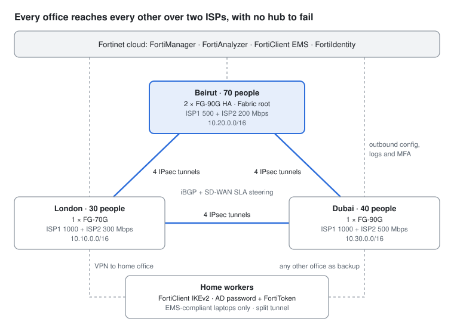

# FortiGate 3-Office Design

A complete Fortinet Security Fabric for a 140-person web and mobile development company with offices in **London, Beirut and Dubai** plus home workers.
The FortiOS configurations are generated from one inventory file and validated by **220 automated tests**; a mutation run shows the tests catch **12 of 12** injected configuration mistakes.



**[Read the full design document →](DESIGN.md)**: bill of materials, IP/VLAN plan, SD-WAN, remote access, policy matrix, test results and deployment runbook.

## Highlights

| Area | Design |
| --- | --- |
| Firewalls | Beirut 2 × FortiGate 90G (active-passive HA, Fabric root), Dubai FG-90G, London FG-70G, FortiOS 7.6.7 |
| WAN | Two ISPs per office, full-mesh IPsec (4 tunnels per office pair, 12 total), iBGP on loopbacks, SD-WAN SLA steering |
| Fail-safe routing | RFC 1918 blackhole routes: if an office's tunnels all drop, internal traffic is dropped, never leaked to the internet |
| LAN | 10 segments per office on FortiSwitch (FortiLink) and Wi-Fi 7 FortiAPs: staff, developers, servers, voice, corporate and guest Wi-Fi, mobile test devices, IoT, cameras, management |
| Remote access | FortiClient IKEv2 IPsec (SSL VPN tunnel mode was removed in FortiOS 7.6.3), EAP-TTLS to Active Directory over LDAPS, FortiToken MFA, EMS posture check, split tunnel, access by AD role |
| Operations | FortiManager Cloud, FortiAnalyzer Cloud, FortiClient EMS Cloud, FortiIdentity Cloud |

## Repository layout

```
inventory/sites.yaml        single source of truth: offices, ISPs, VLANs, hardware
inventory/vpn_users.csv     VPN users (sample) with their AD role
generator/                  model.py (IP plan, tunnels) + generate.py (FortiOS CLI writer)
configs/                    generated FortiOS scripts per office (LON, BEY, DXB)
tests/                      FortiOS CLI parser, policy/routing simulator, 220 tests
tools/mutation_test.py      injects realistic faults and checks the tests catch them
docs/                       project page (GitHub Pages) and network diagram
DESIGN.md                   full design document
```

## Run it

```bash
pip install -r requirements.txt
python3 generator/generate.py        # regenerate configs/ from the inventory
python3 -m pytest                    # 220 tests
python3 tools/mutation_test.py       # 12/12 injected faults detected
```

What the tests cover:

- **Grammar and references:** every script parses, and every interface, address, service, group and profile it references exists.
- **Addressing and VPN:** no overlapping subnets; both ends of all 12 tunnels mirror each other; BGP full mesh; MFA on every VPN user.
- **Traffic simulation:** 34 flows per office and 66 office-to-office flows walked through the real policy tables of both firewalls (for example: guests cannot reach servers, developers can SSH to build servers, cameras have no internet).
- **Resilience:** all 27 combinations of ISP failures keep every office connected; tunnel loss fails closed.
- **Sizing:** datasheet throughput and switch-port capacity per office.

GitHub Actions runs all of this on every push (`.github/workflows/tests.yml`).

## Before using it on real equipment

- All addresses are examples: public IPs come from the RFC 5737 documentation ranges, and the company "Acme Digital" is fictional. Edit the values marked `# CHANGE` in `inventory/sites.yaml`.
- **The keys and passwords in `configs/` are public demo values (they start with `DEMO`).** Run `python3 generator/generate.py --real-secrets` to create random secrets in `inventory/secrets.yaml`, which is git-ignored, and never commit that file.
- The tests check the generated configs offline. Load each script on a FortiGate VM running your target build and follow the lab checklist in [DESIGN.md](DESIGN.md#testing-and-validation) before deployment.

## License

[MIT](LICENSE)
